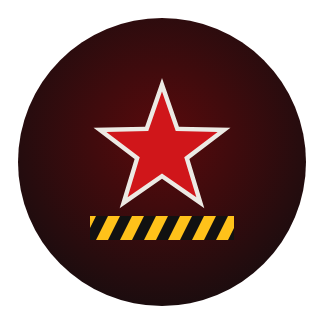

<p align="center">
  
</p>

<h1 align="center">RA3 Native</h1>

<p align="center">
  <b>Command &amp; Conquer: Red Alert 3 running natively on Android</b><br>
  Static recompilation of the original x86 game into ARM64 — no Winlator, no Box64, no emulator at run time.
</p>

<p align="center">
  <a href="https://github.com/blackorange-sketch/RA3-Native/releases/latest"></a>
  <a href="https://github.com/blackorange-sketch/RA3-Native/releases/tag/nightly"></a>
  <a href="https://github.com/blackorange-sketch/RA3-Native/releases"></a>
  
  
  <a href="LICENSE"></a>
</p>

> [!IMPORTANT]
> **No game files are included.** This project contains only tools and a runtime. You need your own legally obtained copy of Red Alert 3 (patch 1.12).

---

## Contents

- [What works](#what-works)
- [Requirements](#requirements)
- [Installation](#installation)
- [Controls](#controls)
- [Launcher options](#launcher-options)
- [Performance](#performance)
- [Known issues](#known-issues)
- [How it works](#how-it-works)
- [Troubleshooting and diagnostics](#troubleshooting-and-diagnostics)
- [Building](#building)
- [License](#license)
- [Legal](#legal)

## What works

| | |
|---|---|
| 🎮 **Gameplay** | Skirmish and campaign, all three factions, saving and loading |
| 🖼️ **Graphics** | Full 3D world, water, shadows, explosions, fire and most weapon effects; all graphics presets selectable in the game's options |
| ⚡ **Performance** | Stable 30 fps in large battles on a Snapdragon 8 Gen 2 (dedicated render thread, shader cache) |
| 🎬 **Video** | Intro, briefings and campaign cutscenes at full speed |
| 👆 **Touch controls** | Tap, long press, drag-select, pan, pinch zoom, camera rotation |
| ⌨️ **Keyboard** | On-screen hotkey buttons and a full keyboard; physical keyboards work too |
| 🌐 **Network** | Windows sockets on top of Android networking; the LAN menu opens — LAN play is being tested |
| 🚀 **Launcher** | Start screen with language, HUD size, cutscene and logging options, background file check |

## Requirements

- **Android 8.0 or newer, 64-bit (arm64)** with OpenGL ES 3.2. Developed and tested on a Snapdragon 8 Gen 2; other recent Snapdragon devices should work.
- **Mali / PowerVR GPUs** — experimental: these GPUs cannot read the game's DXT textures, so they are decoded on the CPU at load time (and large textures are loaded at half resolution to save memory). Reports from Mali devices are very welcome.
- **Red Alert 3, patch 1.12** — the full game folder (about 8.7 GB), copied to the phone's internal storage.
- About **4 GB of free RAM** recommended.

## Installation

1. Download the APK from the [latest stable release](https://github.com/blackorange-sketch/RA3-Native/releases/latest) and install it.
   Want the newest fixes before they are released? The [nightly build](https://github.com/blackorange-sketch/RA3-Native/releases/tag/nightly) is rebuilt after every change — it may be broken. A newer build always installs over an older one, whichever channel it comes from.
2. Copy your game folder to the phone, for example to
   `/sdcard/Command and Conquer - Red Alert 3/`
   (the folder that contains `Data/ra3_1.12.game` and the `RA3_<language>_1.12.SkuDef` files).
3. Open **RA3 Native** and allow **All files access** when asked — the game reads its files directly from storage.
4. The launcher finds the game by itself (or use **Game folder** to pick it), checks the files and unlocks **Play**.

> [!TIP]
> Files the game never uses can be moved out to save space: `Launcher/`, `Support/`, `Trailers/`, the installer files in the root folder and `Data/ra3_1.0.game` … `ra3_1.11.game`. Keep every `.big` archive and every `.SkuDef` file.

## Controls

| Gesture | Action |
|---|---|
| Tap | Left click — select, give orders, press buttons |
| Long press (½ s) | Right click |
| Hold, then drag | Selection box |
| Quick swipe | Scroll the map |
| Two-finger tap | Right click (cancel / deselect) |
| Pinch | Zoom |
| Two-finger drag | Rotate the camera |
| ⌨ button | Show or hide the on-screen keyboard |
| `D` `ENT` `ESC` `SPC` | Hotkeys: special ability, chat, menu, jump to event |
| `EDIT` | Text input through the Android keyboard (player names, chat) |

The phone's volume keys keep working, and the screen stays on while the game runs.

## Launcher options

| Option | Default | |
|---|---|---|
| Interface language | detected | Every language installed in your game folder (`RA3_<language>_1.12.SkuDef`) |
| Cutscenes | On | Intro, briefings and campaign videos |
| Log file | Off in releases, on in nightly builds | Writes `/sdcard/ra3_native.log` — turn it on and attach the file to bug reports |
| HUD size | 110% | Enlarges the minimap, build menu and other corner panels (100–200% in 10% steps) |

## Performance

Measured on a Snapdragon 8 Gen 2 at 1920×1080:

| Settings | Typical battle | Large battle |
|---|---|---|
| Medium | 30 fps | 30 fps |
| High | 30 fps | 28–30 fps |

The game logic itself is capped at 30 fps, like on PC. Rendering runs on its own thread, and compiled shaders are cached (well under 1 MB), so new effects no longer stutter on later runs.

## Known issues

- **Some laser weapons are invisible** (for example the King Oni's eye lasers). The effect is drawn but not visible; it is being investigated.
- **Online play** — the original GameSpy servers were shut down in 2014. Support for the community C&C:Online servers is planned.
- **LAN play** is new and largely untested.
- The game runs at **30 fps**, as on PC. An experimental 60 fps mode (`/sdcard/ra3_fps60`) exists but is not usable yet: the game's engine ties its logic and effects to the frame rate.
- The game's interface is not scaled for small screens yet.

Found something else? Please [open an issue](https://github.com/blackorange-sketch/RA3-Native/issues) with your device model and the `ra3_native.log` file.

## How it works

Red Alert 3 is a 32-bit Windows program. Instead of emulating an x86 CPU while you play, every function of the game is translated ahead of time into C++ and compiled for ARM64:

```
ra3_1.12.game ──► analyser + lifter (tools/) ──► C++ per function ──► clang ──► libra3native.so
                                                                                     │
                     Android runtime (runtime/): Win32 · D3D9 → OpenGL ES · audio · input · sockets
```

- **`tools/`** — a static analyser and lifter built on [Capstone](https://www.capstone-engine.org/). It finds every function in the executable and emits C++ (`f_XXXXXXXX(CPU*)`) with the x86 registers held as host locals.
- **`runtime/`** — what the translated code runs against:
  - PE loader and a 4 GB guest address space
  - Win32, MSVCRT, DirectSound, XInput and WinSock import layers
  - **Direct3D 9 → OpenGL ES 3** renderer: shader translation from D3D bytecode to GLSL, the D3DX effect framework (FX9) including preshaders, a dedicated render thread and a program binary cache
  - NEON versions of the MMX routines used by the VP6 video decoder
  - Touch input mapped to the RTS mouse and keyboard controls
- **`android/`** — the APK: launcher, native activity and the build scripts.

GitHub Actions builds everything: it fetches the game executable from a private location, runs the lifter, compiles the generated code and packages the APK. Generated code and game files are never committed.

## Troubleshooting and diagnostics

Empty files with these names in `/sdcard` change the runtime's behaviour:

| File | Effect |
|---|---|
| `ra3_st` | Render on the game thread instead of the render thread |
| `ra3_nocache` | Re-send all graphics state for every draw (rules out state-cache bugs) |
| `ra3_verbose` | Much more detailed log |
| `ra3_prof` | CPU sampling profiler, report in the log every 30 s |
| `ra3_fxstat` | Per-effect draw statistics |
| `ra3_frame` | Full trace of two frames (and render-target dumps into `/sdcard/ra3_dump/` if that folder exists) |
| `ra3_fps60` | Experimental 60 fps cap (effects and game speed are still wrong) |
| `ra3_fulltex` | Mali / PowerVR: load large textures at full resolution (uses about 4× more memory) |

Remove them again for normal play — some of them slow the game down.

## Building

The APK is built by [`.github/workflows/android.yml`](.github/workflows/android.yml). To build it in your own fork you need the game executable available to the workflow (see the workflow for the expected secret and release).

The analyser alone:

```sh
g++ -O2 -std=c++17 -I<capstone>/include tools/analyze.cpp <capstone>/libcapstone.a -o analyze
./analyze ra3_1.12.game out
```

## License

The code in this repository is licensed under the [GNU General Public License v3.0](LICENSE). Forks and modified builds are welcome under its terms, which means the source of distributed changes stays open under the same license. Please credit RA3 Native with a link to this repository, and never bundle game files. Pull requests — especially for device compatibility — are appreciated.

## Legal

This is an unofficial, non-commercial fan and research project. It is not affiliated with, endorsed or sponsored by Electronic Arts. *Command & Conquer* and *Red Alert* are trademarks of Electronic Arts Inc. No game code or assets are distributed — you must own the game. The app icon is an original design.
